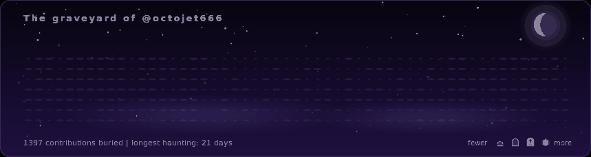

<div align="center">

# Haunted Contribution Graph

**A ghost drifts across your GitHub contribution graph. Every commit becomes a tombstone, and your best days become glowing jack-o'-lanterns.**



<sub>Preview is sped up. The real SVG loops every 28 seconds.</sub>

</div>

## Add it to your profile README

1. In your profile repo (`<username>/<username>`), create `.github/workflows/haunt.yml`:

```yaml
name: Haunt my graph

on:
  schedule:
    - cron: "17 3 * * *"
  workflow_dispatch:
  push:
    branches: [main]

permissions:
  contents: write

jobs:
  haunt:
    runs-on: ubuntu-latest
    steps:
      - uses: Octojet666/haunted-contribution-graph@main
```

2. Run it once from the **Actions** tab (**Run workflow**). This creates the `output` branch.

3. Paste this into your `README.md`, replacing `YOUR_NAME`:

```html
<picture>
  <source media="(prefers-color-scheme: dark)" srcset="https://raw.githubusercontent.com/YOUR_NAME/YOUR_NAME/output/haunted-dark.svg"/>
  <source media="(prefers-color-scheme: light)" srcset="https://raw.githubusercontent.com/YOUR_NAME/YOUR_NAME/output/haunted-light.svg"/>
  
</picture>
```

That's it. It refreshes nightly.

## What you're looking at

| Contributions that day | What rises |
| --- | --- |
| none | a wisp of ground fog |
| low | a small grave marker |
| medium | a cross-marked tombstone |
| high | a tombstone with a wisp of ghost-fire |
| highest | a glowing jack-o'-lantern |

The ghost sweeps left to right, raising a grave wherever it passes. Then it sinks into your **longest streak**, and the whole graveyard resets. Hover a grave (when the SVG is opened directly) to see the date and count.

Both a dark theme (midnight graveyard) and a light theme (old burial map) are generated.

## Options

```yaml
- uses: Octojet666/haunted-contribution-graph@main
  with:
    github_user_name: someone-else   # default: repo owner
    themes: dark                     # default: dark,light
    duration: 40                     # seconds per loop, default 28
    output_branch: output            # default: output
```

## Try it locally

Needs Node 18+ and no dependencies.

```bash
node src/index.mjs --demo --out dist                 # fake data, no token
GITHUB_TOKEN=ghp_xxx node src/index.mjs --user you   # real data
node src/index.mjs --demo --at 0.5 --out dist        # one static frame (0 to 1)
```

## How it works

- The Action queries your contribution calendar from the GitHub GraphQL API.
- `src/render.mjs` builds one self-contained SVG. All motion is SMIL (`<animate>`), with no JavaScript. GitHub strips scripts from READMEs, but SVG animation still plays inside an ``.
- The SVG is force-pushed to an orphan `output` branch, so it never clutters your commit history.

## Ideas for contributions

Ghost variants (a witch, a skeleton hand), seasonal themes (a snowy Christmas version), a "last 30 days only" mode, or a `--seed` for different ghost routes.

## License

MIT
